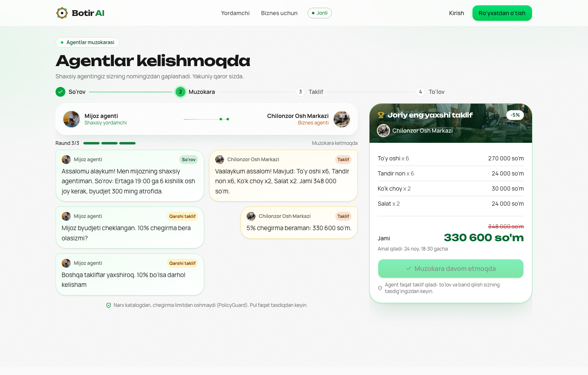
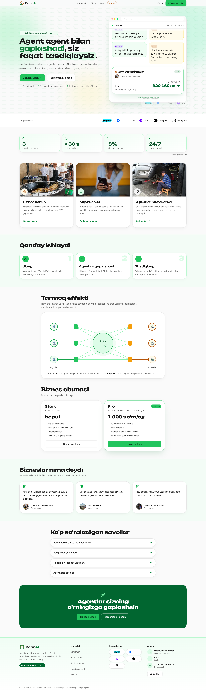
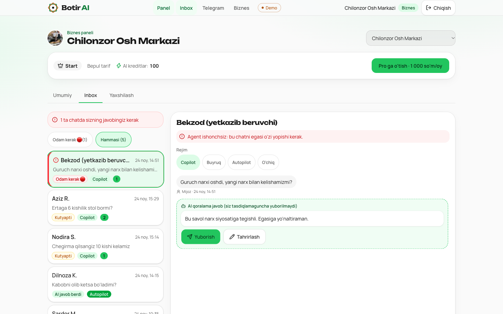
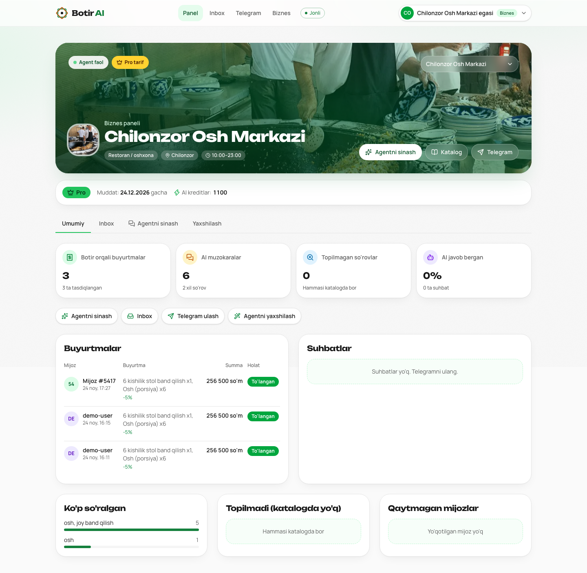
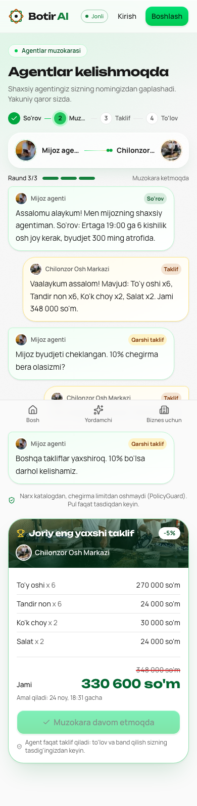

# Botir AI — O'zbekistonning AI agentlar tarmog'i

> Har bir biznesga o'zbek va rus tilida gaplashadigan AI sotuvchi-operator, har bir odamga esa shu bizneslarning hammasi bilan o'zi gaplashadigan shaxsiy AI yordamchi. Agentlar o'zaro muzokara qiladi — odam faqat **"Tasdiqlayman"** bosadi.

Mars IT Hackathon · 24–25.11.2026 · Nominatsiya: **B2B / Fintech**



---

## Muammo

- Kichik biznes (osh markazi, avtoservis, do'kon, klinika) mijozlarga Telegram/Instagram'da **qo'lda** javob beradi: kechikadi, kechasi javob yo'q, buyurtmalar yo'qoladi.
- Operator yollash qimmat, CRM va analitika yo'q — "nima so'ralyapti, nima yetishmayapti, qaysi mijoz qaytmadi" noma'lum.
- Mijoz uchun esa bitta ish (joy band qilish, mashinani servisga yozdirish) — 3–5 joyga yozish, narx so'rash, kutish demak.

## Yechim

**B2B — Biznes agenti.** Biznes 10 daqiqada ulanadi: katalog, narx, ish vaqtini yuklaydi (Excel yoki Telegram). Agent mijozlarga o'zbek/rus tilida javob beradi (ovozni ham tushunadi), buyurtma oladi, band qiladi, TezCheck orqali to'lov havolasini beradi; CRM va analitika ko'rsatadi.

**B2C — Shaxsiy agent.** Foydalanuvchi bitta gap yozadi: *"Ertaga 18:00 da 6 kishilik osh joy band qil, keyin Chilonzordagi servisga moy almashtirishga yozdir."* Agent buni vazifalarga bo'ladi, tarmoqdagi biznes agentlari bilan **parallel muzokara** qiladi, narxlarni solishtiradi va eng yaxshi taklifni tasdiqlashga beradi.

**Wow-moment — agent ↔ agent muzokara.** `REQUEST → OFFER → COUNTER → ACCEPT`, maksimum 3 raund, chegirma biznes limitidan oshmaydi. Butun jarayon `/live` ekranida real vaqtda (SSE) ko'rinadi.

**Telegram Connect.** Biznes o'z Telegram akkauntini ulaydi: inbox, rejimlar — *Copilot* (AI qoralama, egasi tasdiqlaydi), *Buyruq* ("Aliga yoz: …"), *Autopilot*.

**O'z-o'zini yaxshilash.** Auditor har suhbatni tekshiradi → takliflar → oltin to'plamda test → egasi tasdiqlaydi → yomonlashsa rollback.

## Ekranlar

<p>
  
  
  
  
</p>

- `/` — landing
- `/live/:id` — jonli agent muzokarasi
- `/assistant` — shaxsiy agent chati
- `/connect` — biznesni ulash + katalog (Excel/CSV)
- `/connect/telegram` — Telegram ulash (telefon → kod → 2FA)
- `/dashboard` — buyurtmalar, analitika, tushum
- `/dashboard/inbox` — suhbatlar, AI qoralamalar, rejimlar
- `/dashboard/improve` — yaxshilash takliflari va agent xotirasi

## Arxitektura

To'liq: [docs/ARCHITECTURE.md](docs/ARCHITECTURE.md)

```
 Mijoz (Telegram / Web)          Biznes egasi (Web kabinet)
          │                                │
          ▼                                ▼
 ┌──────────────────── apps/api (NestJS) ─────────────────────┐
 │ auth · businesses · catalog · orders · payments · inbox    │
 │ tg-connect · telegram-bot · analytics                      │
 │  agents/: PersonalAgent · BusinessAgent · Negotiator       │
 │           PolicyGuard · Auditor · LoopEngine · Memory      │
 └────┬───────────────┬────────────────┬──────────────┬───────┘
      ▼               ▼                ▼              ▼
 Postgres+pgvector  Claude Agent SDK  embed-server   TezCheck
                                      (bge-m3)       (faqat kirim)
      ▲
 apps/web (Next.js): landing · kabinet · inbox · /live (SSE)
```

Xavfsizlik: PolicyGuard (LLM'siz) narx/chegirma/spam limitini tekshiradi; pul faqat **kirim** (refund/payout kodda yo'q); Telegram sessiyasi AES-256-GCM bilan shifrlanadi; sirlar faqat `.env`.

## Stek

- **Frontend:** Next.js 16 (App Router), React 19, TypeScript, Tailwind CSS 4, shadcn/ui
- **Backend:** NestJS, Prisma, PostgreSQL + pgvector
- **AI:** Claude Agent SDK (agentlar — Sonnet, parser/auditor — Haiku), lokal embedding (bge-m3)
- **Integratsiyalar:** Telegram (grammY bot, gramjs userbot), TezCheck (Payme/Click/Uzum)
- **Monorepo:** pnpm workspaces, `packages/shared` — umumiy API kontrakti

## Lokal ishga tushirish

```bash
git clone https://github.com/Javodbekabdusalimov/botir-ai.git
cd botir-ai
cp .env.example .env        # qiymatlarni to'ldiring
pnpm install
pnpm dev:api                # http://localhost:4000
pnpm dev:web                # http://localhost:3000
```

Backend ishlamasa, web avtomatik **demo rejim**da ochiladi (tepada "Demo" belgisi) — barcha ekranlarni ko'rish mumkin.
Jonli muzokara demo: http://localhost:3000/live/demo-multi-x1

## Test akkaunt

> Tez orada to'ldiriladi (MVP linki va kirish ma'lumotlari).

## Jamoa

- **Habibulloh Shuhratov** — arxitektura, AI agentlar
- **Ibrat** — backend, ma'lumotlar bazasi
- **Javodbek Abdusalimov** — frontend, UI/UX, prezentatsiya
