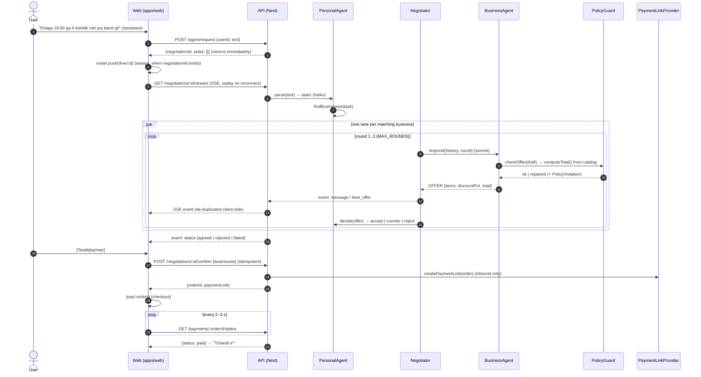
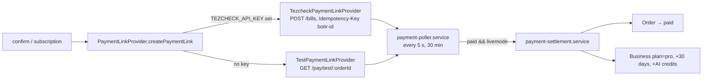
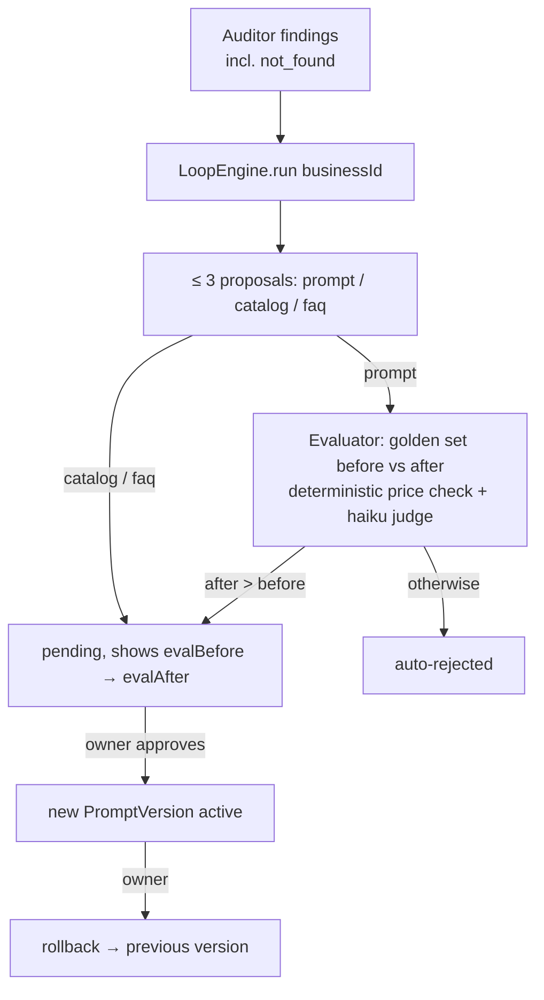
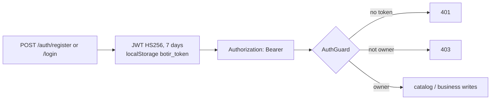

# Life Assistant — flows (sequence diagrams)

Companion to `AGENTS.md`. Each diagram names the real files involved, so a reader can jump straight to the code.

## 1. Client request → live negotiation → confirm → payment

Failure handling in the web client (`apps/web/src/lib/api.ts`, `app/live/[id]/live-view.tsx`):
- SSE drops before the stream finishes → automatic reconnect (1 s, 2 s, 4 s, 4 s, 4 s); replayed events are skipped.
- Stream ends with `rejected`/`failed` → "Bu safar kelishuv bo'lmadi" + [Qayta urinish] (re-sends the original text) + [So'rovni o'zgartirish].
- `GET /payments/:id/status` → 404 → `NotFoundError` → "Buyurtma topilmadi" (never a fake "paid").
- Backend unreachable → scripted mock and the header badge switches to "Demo".

## 2. Payment settlement (no webhooks)

No refund, payout, withdraw or cancel path exists. The TezCheck client makes exactly two calls: create bill, read bill.

## 3. Self-improvement loop (human in the loop)

Nothing changes agent behaviour until the owner approves. Catalog proposals never invent a price; the owner sets it.

## 4. Auth and ownership

Public (no login): `GET` businesses, catalog, analytics; `POST /agent/request`; SSE stream; confirm; payment status.
